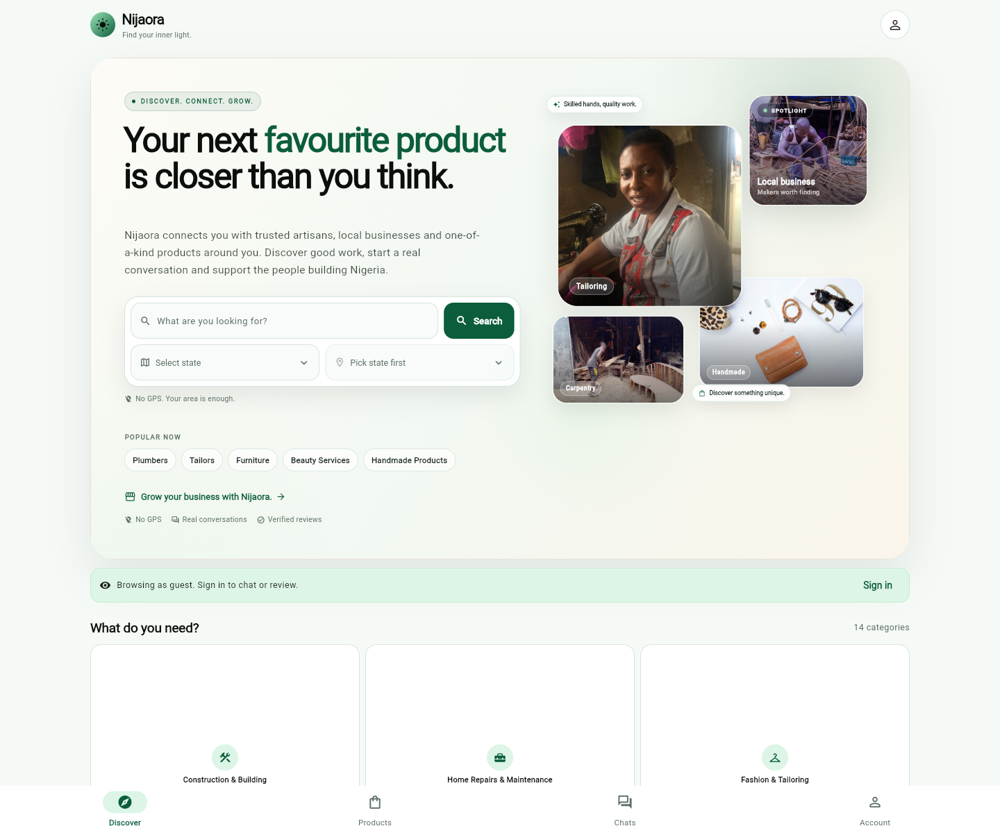
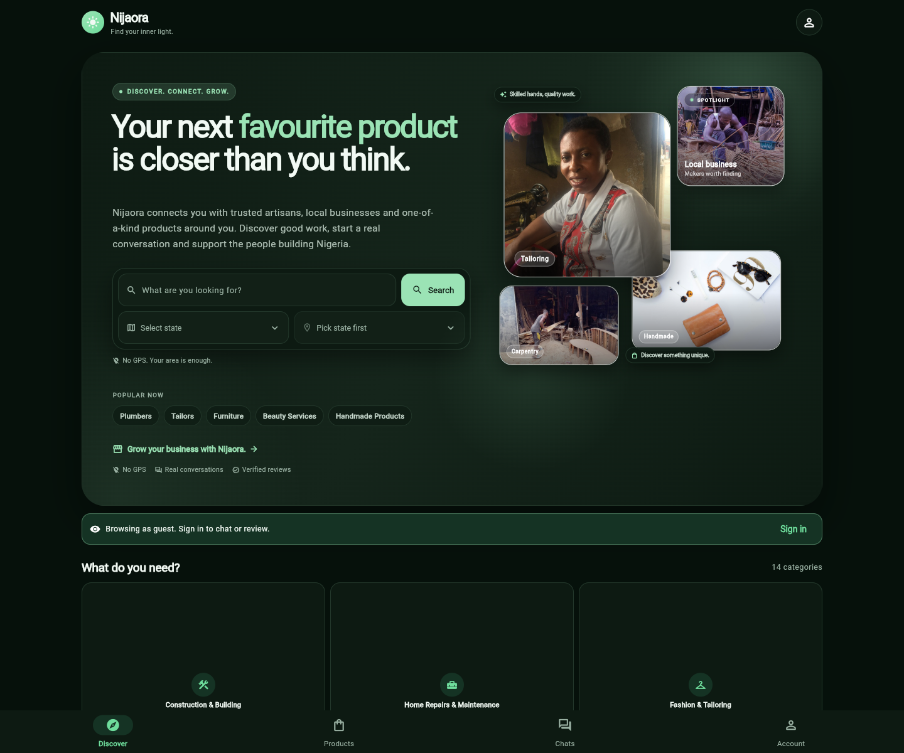
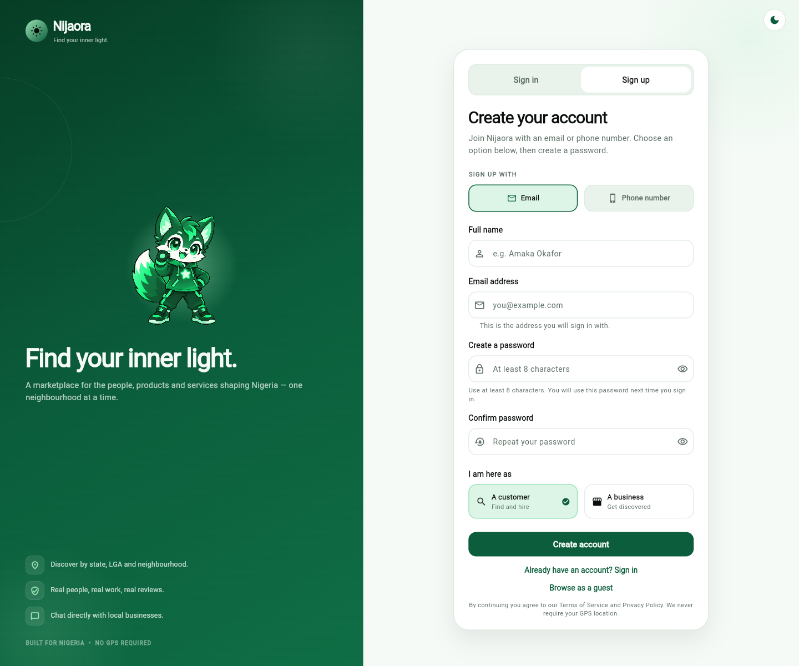
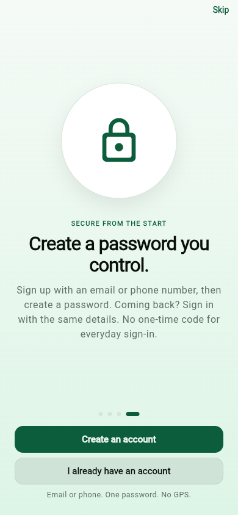

# Nijaora

Area-based discovery for trusted local businesses in Nigeria. Customers pick a
state, LGA and (optionally) a neighbourhood instead of sharing GPS; businesses
register where they are based and where they can work.

Tagline: **Find your inner light.**

## Live preview

[Open the Nijaora web preview](https://dammydaly-ops.github.io/nijaora/)

The preview is built in demo mode so it is fully browsable without a Supabase
session. Demo accounts and registrations live in the browser's local storage.
Production auth and publishing use Supabase when the app is built with
`AUTH_BACKEND=supabase` and a publishable key.

## Screenshots

| Home, light | Home, dark |
| --- | --- |
|  |  |

| Password sign-up | Onboarding, password page |
| --- | --- |
|  |  |

- Product review: [`docs/prd-review.md`](docs/prd-review.md)
- Architecture and scope: [`docs/architecture.md`](docs/architecture.md)
- Supabase schema: [`supabase/migrations`](supabase/migrations)
- Firebase deploy notes: [`firebase/README.md`](firebase/README.md)

## Status

Supabase is now the primary data backend. The app still ships with a bundled
demo catalogue so it can run before the remote project is configured, but reads
switch to Supabase as soon as a publishable/anon key is supplied.

| Area | State |
|---|---|
| Theme, routing, auth guards | Built |
| Splash + first-launch onboarding | Built; four onboarding pages, then sign-in or sign-up |
| Sign-in / sign-up screen | Built; split-screen desktop layout, email or phone sign-in, password, role |
| Password authentication | Built for demo and Supabase; email/password works now, phone/password needs Supabase Phone + SMS |
| Legacy phone OTP | Kept for debug/phone confirmation; not linked from normal sign-in |
| Guest browsing | Built |
| Location picker (state → LGA → neighbourhood) | Built, all 37 states + 774 LGAs |
| Home hero | Built; responsive editorial layout, animated collage, working area search |
| Home, search, filters, sorting, pagination | Built |
| Business profile, portfolio, reviews, trust panel | Built |
| Optional public business address | Built; shown on the public profile |
| Chat inbox + thread with listing context | Built (demo replies); WhatsApp fallback available |
| Business registration wizard + PRD validations | Built (demo publish; Supabase publish path written) |
| Products tab + product detail + seller card | Built |
| Service and product category picker | Built, 14 service parents + product tree |
| Real device photo picking | Built; data URLs in demo, Supabase Storage path ready |
| Supabase schema, RLS, triggers, RPCs | Applied to the remote project |
| Supabase reference data | Applied: 37 states, 774 LGAs, 27 neighbourhoods, 156 categories |
| Supabase Storage buckets + policies | Applied via migration; empty until real owners register |
| Reviews submission, FCM, Typesense, admin console | Not built |

## Run it

Flutter 3.47+ / Dart 3.13+.

```bash
flutter pub get
flutter run                 # demo backend, Android/web/desktop
flutter test
flutter analyze
```

### Demo sign-in and sign-up

1. Pick **Sign in** or **Sign up**.
2. Choose **Email** or **Phone number**.
3. For a new account, enter a full name, your email/phone, a password of at
   least eight characters, confirm the password, and choose **A customer** or
   **A business**.
4. On later visits, choose the same method, enter the same email/phone and
   password, then tap **Sign in**. No OTP is needed.
5. Or tap **Browse as guest** (chat and registration still require sign-in).

The demo backend stores a salted SHA-256 password hash per account in local
storage. It does not store the password in plain text. The old six-digit demo
OTP path remains in the codebase for debug verification, but it is not linked
from the normal sign-in screen.

Real password auth uses Supabase. Email/password works with the email provider.
Phone/password additionally needs the Phone provider and an SMS provider; if
phone confirmation is enabled, the first sign-up may ask for a code once, and
returning sign-ins still use the password.

### Splash and onboarding

Every launch shows a branded splash while auth and saved preferences load. On a
fresh install, a four-page onboarding introduces area-based discovery, owner
trust signals, chat/WhatsApp and password-protected accounts. The last page can
send a new visitor straight to sign-up (where the password fields are visible)
or to sign-in for an existing account. The flow is remembered in local
preferences, so it is not shown again.

The onboarding and sign-in screens use the Nijaora fox mascot. It is bundled as
one transparent white/green PNG and used in both light and dark mode, with a
theme-aware glow behind it. The mascot is recoloured from the supplied owner
artwork; the source is not fetched from a third-party image CDN.

Seeded businesses include Radiance Tailors, Mama Nkechi Stitches, FlowFix
Plumbing, BrightSpark Electricals, Adebayo Woodworks, Glow by Tola, Lekki
Threads, Chinedu Plumbing, Ibadan Carpentry Hub, Amaka's Accessories, Mama
Ngozi's Kitchen, Sparkline Electricals and VI Plumbing Works.

## Supabase mode

The project URL is committed in `lib/core/config/app_config.dart`; the
publishable/anon key is supplied at build time and is never committed.

```powershell
$env:SUPABASE_ANON_KEY="YOUR_PUBLISHABLE_KEY"
flutter run --dart-define=SUPABASE_ANON_KEY=$env:SUPABASE_ANON_KEY
```

This enables Supabase reads for locations, categories, businesses and listings.
If a query fails (for example, because migrations have not been applied yet), the
repository falls back to the bundled demo catalogue.

### Apply the migrations

The easiest path is to open `supabase/apply_all.sql` in the Supabase SQL editor
and run it once. It is the five migrations concatenated in order, wrapped in a
transaction.

You can also run them individually in order, or with the Supabase CLI:

1. `supabase/migrations/20261027000000_initial_schema.sql`
2. `supabase/migrations/20261027000100_reference_data.sql`
3. `supabase/migrations/20261027000200_storage_buckets.sql`
4. `supabase/migrations/20261027000300_grants.sql`
5. `supabase/migrations/20261112000000_business_address.sql`

The fifth migration adds the optional public `businesses.address` column. The
address is only shown when an owner supplies one; it is not required for
publishing and does not affect ranking. Run this migration (or the updated
`apply_all.sql`) remotely before publishing a business that includes an address.

If the schema and reference data already exist but the API returns
`permission denied for table ...`, run only the grants migration:

`supabase/migrations/20261027000300_grants.sql`

Then verify in SQL:

```sql
select count(*) from public.states;          -- 37
select count(*) from public.lgas;            -- 774
select count(*) from public.neighbourhoods;  -- 27
select count(*) from public.categories;      -- 156
```

Or check the live project from the terminal with the publishable key:

```bash
# PowerShell
$env:SUPABASE_URL="https://jipythusnrclazfjkkqp.supabase.co"
$env:SUPABASE_ANON_KEY="YOUR_PUBLISHABLE_KEY"
node scripts/check_supabase.mjs
```

The reference migration creates the pilot neighbourhoods for Ikeja, Surulere,
Eti-Osa, Ibadan North and AMAC. The rest of the country can still be browsed at
state/LGA level.

Use only the publishable/anon key in the app. Never put a `service_role` key in a
Flutter build.

### Real password auth

Password sign-up and sign-in are implemented in
`lib/data/sources/supabase/supabase_auth_repository.dart`. Enable the Supabase
backend with:

```powershell
$env:SUPABASE_ANON_KEY="YOUR_PUBLISHABLE_KEY"
flutter run `
  --dart-define=AUTH_BACKEND=supabase `
  --dart-define=SUPABASE_ANON_KEY=$env:SUPABASE_ANON_KEY
```

Email/password uses Supabase's email provider. If email confirmation is enabled,
Supabase sends a confirmation message at sign-up; after confirming, the person
signs in with their password. Phone/password needs
**Authentication → Providers → Phone** plus Twilio (or another supported
provider). The project currently reports `phone: false` in its auth settings, so
phone/password remains unavailable until that provider is enabled.

If phone confirmation is enabled, a new phone sign-up is sent to the code screen
once to confirm the number. The password is already set, so all returning
sign-ins use email/phone + password instead of OTP.

### Publishing and photos

When `AUTH_BACKEND=supabase`, registration writes the business, categories,
first listing and profile owner details to Supabase. Picked photos are uploaded
to the `business-photos` and `profile-photos` buckets; if Storage is unavailable
they stay as local data URLs.

The Supabase publish path is deliberately not used with demo auth because there
is no authenticated Supabase user for RLS.

### Photo credits and brand assets

The home hero uses the CC0 “Beautiful Nigerian Tailor” portrait by Deinma
Standfast, plus `carpenter-nigeria.jpg`, `makeup-nigeria.jpg`, `products.jpg`,
`service.jpg` and `shop-owner-nigeria.jpg`. These are free-licence
Unsplash/Wikimedia Commons images bundled locally so the collage works offline.
They are placeholders for launch; swap in owner-approved portraits and portfolio
photos as real businesses join the pilot.

The four supplied maker photographs under `assets/images/hero/story-*.png`
(woodcarving, tailoring, pottery and ceramics) are also bundled for a future
editorial slot. The current hero intentionally uses the original collage.

The app icon, adaptive Android icon, web favicon, iOS/macOS icons and Windows
`.ico` are all generated from the official Nijaora marketplace logo:
[`assets/brand/nijaora_app_icon.png`](assets/brand/nijaora_app_icon.png).
Android uses an adaptive icon with the N-and-bag mark on a forest field. Both
Android and iOS use the forest-green native launch screen with the centred logo.

The fox mascot is supplied owner artwork, bundled in `assets/images/` as
`mascot_light.png` and recoloured for the Nijaora palette. The same white/green
artwork is used in both themes.

### Chat and WhatsApp

The in-app chat currently uses `DemoChatRepository`. It keeps conversations in
memory, adds messages immediately with a sending/sent indicator, schedules a
canned business reply after a short delay, and tracks unread counts per side.
It is useful for testing the customer and business inbox flow, but it resets
when the app restarts and does not sync between two devices. The Supabase
`conversations`/`messages` tables, triggers and RLS policies already exist; a
Supabase-backed chat repository is still pending.

WhatsApp is the optional fallback for customers who do not want to use the
in-app chat. A business can add a WhatsApp number during registration. The app
then exposes **WhatsApp** on the business profile, **WhatsApp seller** on product
pages, and **Continue on WhatsApp** from the chat thread app bar/menu. It opens
`wa.me` with a pre-filled message. If a business has not added a number, the
button is hidden.

## How it is structured

Feature-first Flutter with Riverpod and `go_router`:

```
lib/
  app/        # bootstrap, router, shell, brand theme
  core/       # config, errors, formatters, services, shared widgets
  data/       # models, repositories (interfaces + demo/supabase), search engine
  features/   # auth, location, discovery, business, chat, products, registration
supabase/
  migrations/ # schema, reference data, storage buckets
```

Rules of thumb:

- UI talks to Riverpod providers, never to Supabase directly.
- Repositories are the only backend-aware layer; `AUTH_BACKEND` selects the auth
  implementation.
- `FallbackBusinessRepository` uses Supabase first and the demo catalogue only
  when a query fails, so the app remains usable during migration.
- Search criteria is one immutable `SearchQuery`; area matching, filters and
  ranking live in `lib/data/search/search_engine.dart` and are unit-tested.
- Fixed-location businesses match their base LGA; mobile businesses match their
  declared service LGAs. Thin results fall back to curated adjacent LGAs.
- Ranking is deterministic:
  `0.40 relevance + 0.20 area + 0.15 completeness + 0.15 response + 0.10 rating`
  (rating only counts from 5 reviews; neighbourhood match adds 0.02).

## Products

Products are a separate browse experience from services:

- 14 parent service categories with trades underneath.
- A product tree covering fashion, furniture, crafts, food, beauty, electronics,
  building materials, agriculture, art, baby and auto.
- The Products tab has search, parent-category chips, a product grid, product
  detail pages and a seller card with chat entry.
- Registration has a **Services / Products** switch. Product sellers pick a
  product category and add a first product, which appears in Products after
  publishing.

## Tests

```bash
flutter test
```

Covers location pair validation, fixed vs mobile area matching, nearby-LGA
fallback, ranking weights and thresholds, PRD 5.8 validation copy, Products
rendering, app boot for signed-out and guest users, first-launch onboarding,
WhatsApp fallbacks, and per-phone demo OTP persistence.

## Known gaps

- The Supabase schema and reference data are applied to the remote project.
  Live reads are verified with `node scripts/check_supabase.mjs` (37 states,
  774 LGAs, 27 neighbourhoods, 156 categories).
- The production marketplace is intentionally empty until real owners register;
  no demo businesses are seeded into Supabase.
- Supabase phone auth needs an SMS provider in the dashboard.
- The demo catalogue is still used when Supabase is not configured or a query
  fails.
- Chat is demo-backed; production writes, unread counters and push are pending.
- Reviews are read-only in the app; submission and eligibility callables are
  specified but not built.
- Search uses the in-memory engine; Typesense sync is the planned production
  path.
- Admin console, SEO pages, OTP fallback provider and pilot analytics are not
  built.
